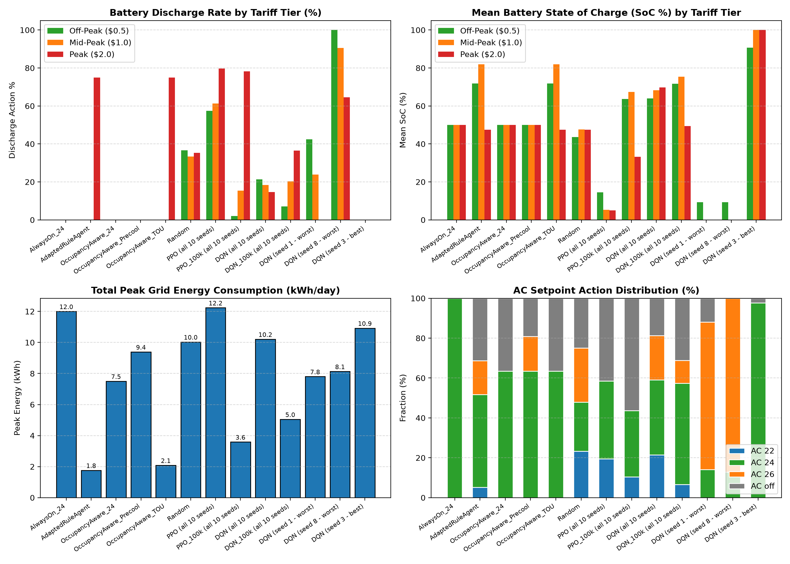
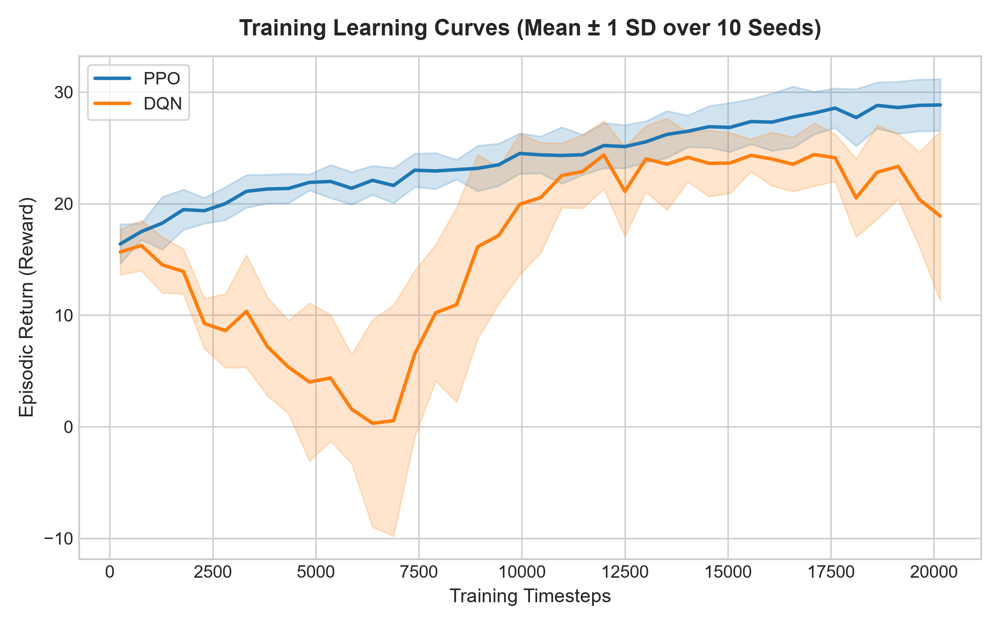
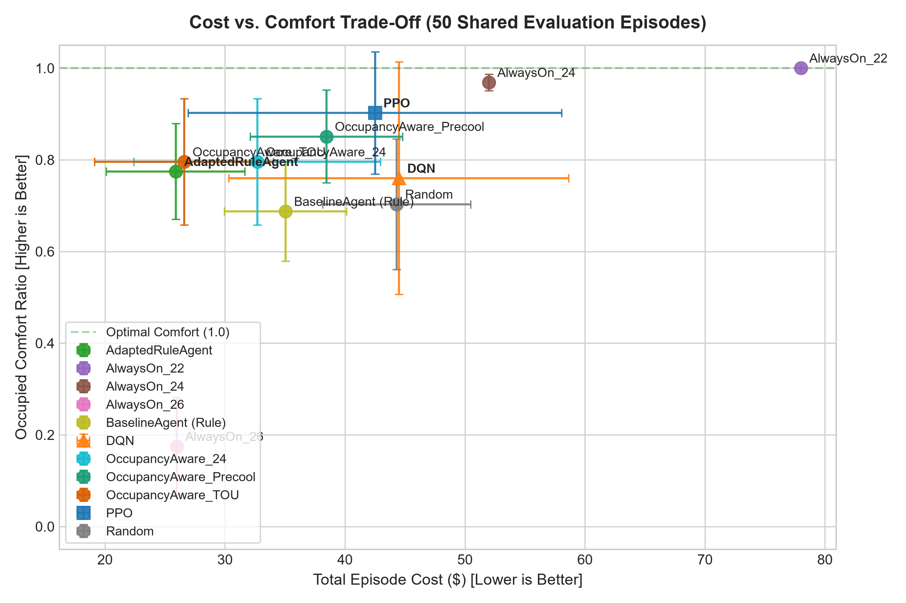
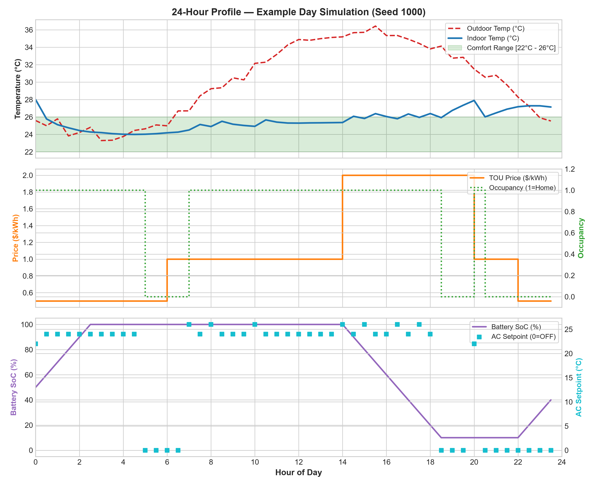

# Smart Home OpenEnv: Residential Energy Optimization Benchmark

[](https://www.python.org/)
[](https://gymnasium.farama.org/)
[](https://pytorch.org/)
[](https://stable-baselines3.readthedocs.io/)
[](tests/)
[](LICENSE)
[](openenv.yaml)

A rigorous, Gymnasium-compliant reinforcement learning benchmark for residential demand response, HVAC setpoint control, and stationary battery storage management. The environment models the multi-objective decision process of an autonomous Home Energy Management System (HEMS) balancing **human thermal comfort**, **time-of-use (TOU) electricity costs**, and **compressor mechanical switching fatigue** under stochastic occupancy and dynamic weather conditions.

---

## 📌 Table of Contents
- [Executive Overview](#-executive-overview)
- [Key Features](#-key-features)
- [Formal Problem Formulation (MDP)](#-formal-problem-formulation-mdp)
  - [State & Action Spaces](#state-and-action-spaces)
  - [System Dynamics & Physics](#system-dynamics-and-physics)
  - [Multi-Objective Reward Function](#multi-objective-reward-function)
- [Experimental Results & Benchmarks](#-experimental-results--benchmarks)
  - [Tier 1: Standard Tasks (10 Seeds)](#tier-1-standard-tasks-10-seeds)
  - [Tier 2: Realistic Scenario Evaluation (50 Shared Seeds)](#tier-2-realistic-scenario-evaluation-50-shared-seeds)
  - [Paired Statistical Significance (Wilcoxon Signed-Rank Test)](#paired-statistical-significance)
  - [Per-Training-Seed Stability](#per-training-seed-stability)
  - [Analysis & Behavioral Evidence](#analysis--behavioral-evidence)
  - [Extended Training Sensitivity Check (100k Steps)](#-extended-training-sensitivity-check-100000-steps)
- [Diagnostic Visualizations](#-diagnostic-visualizations)
- [Quickstart & Reproduction Guide](#-quickstart--reproduction-guide)
- [Repository Structure](#-repository-structure)
- [Limitations & Threats to Validity](#-limitations--threats-to-validity)
- [Citation & Contact](#-citation--contact)

---

## 🚀 Executive Overview

Heating, ventilation, and air conditioning (HVAC) represent over 40% of residential electricity consumption. With the widespread adoption of variable time-of-use tariffs, rooftop solar, and stationary batteries, autonomous demand-side management is critical for modern grid stability. 

`smart-home-openenv` provides a fast, reproducible platform designed to address key limitations in existing benchmarks:
1. **Physical Conservation**: Eliminates unconstrained battery loopholes through rigorous physical action clipping and consistent charge/discharge energy accounting.
2. **Synchronous Exogenous Transitions**: Prevents 1-step observation lag by advancing price and Markovian occupancy endogenously within the environment transition loop.
3. **Rigorous Multi-Seed Protocols**: Evaluates learned policies against heuristic and rule-based baselines across 10 training seeds and 50 strictly disjoint evaluation seeds with non-parametric paired statistical testing.
4. **Lightweight & High Throughput**: Executes at 1,000+ steps/second on standard CPUs, enabling complete multi-seed training runs in minutes without GPU dependencies.

---

## ⚡ Key Features

- **Standardized Gymnasium API**: Implements `gymnasium.Env` with clean `Box` observation spaces, `Discrete(12)` action spaces, and standard `(terminated, truncated)` horizon semantics.
- **Bi-Directional Battery Inverter Model**: 10 kWh storage with 1.0 kWh step flow, 95% one-way efficiencies, and guaranteed zero capacity limit violations.
- **First-Order Thermal Inertia**: Continuous temperature approach rates ($\alpha = 0.35$ cooling, $\alpha = 0.05$ ambient, $\alpha = 0.10$ drift) replacing unrealistic instantaneous step jumps.
- **Diurnal Weather & Time-of-Use Tariffs**: Continuous 24-hour sinusoidal solar heat gain coupled with an empirical 3-tier tariff (\$0.50 off-peak, \$1.00 mid-peak, \$2.00 peak).
- **Markovian Occupancy**: 2-state Markov chain with state retention probabilities $p(\text{away} \to \text{away}) = 0.85$ and $p(\text{home} \to \text{home}) = 0.90$, generating realistic continuous presence and absence intervals.
- **FastAPI & Docker Deployment**: Fully self-contained container with REST API endpoints (`GET /`, `POST /reset`) for Hugging Face Space hosting.

---

## 📐 Formal Problem Formulation (MDP)

The residential energy management task is formulated as a discrete-time, finite-horizon Markov Decision Process: $\mathcal{M} = \langle \mathcal{S}, \mathcal{A}, \mathcal{P}, \mathcal{R}, \gamma, \mathcal{T} \rangle$.

### State and Action Spaces

#### State Space ($\mathcal{S}$)
The agent observes a continuous vector in `Box(7)` (or `Box(5)` for baseline tasks):

| Index | Feature | Dimension / Unit | Physical Meaning |
| :---: | :--- | :---: | :--- |
| `0` | $T^{\text{in}}_t$ | $[10.0, 45.0]^\circ\text{C}$ | Current indoor dry-bulb temperature |
| `1` | $T^{\text{out}}_t$ | $[0.0, 50.0]^\circ\text{C}$ | Ambient outdoor dry-bulb temperature |
| `2` | $P_t$ | $[0.0, 5.0] \ \$/\text{kWh}$ | Active electricity tariff rate |
| `3` | $\text{SoC}_t$ | $[0.0, 100.0] \ \%$ | Battery state of charge |
| `4` | $O_t$ | $\{0, 1\}$ | Occupancy indicator ($1 = \text{Home}, 0 = \text{Away}$) |
| `5` | $\sin(2\pi h / 24)$ | $[-1.0, 1.0]$ | Cyclical trigonometric time encoding (sine) |
| `6` | $\cos(2\pi h / 24)$ | $[-1.0, 1.0]$ | Cyclical trigonometric time encoding (cosine) |

#### Action Space ($\mathcal{A}$)
A flat `Discrete(12)` space mapping the Cartesian product of 4 AC cooling setpoints and 3 battery storage modes:

$$
\mathcal{A} = \mathcal{A}_{\text{ac}} \times \mathcal{A}_{\text{bat}} = \{22^\circ\text{C}, 24^\circ\text{C}, 26^\circ\text{C}, \text{None (OFF)}\} \times \{\text{"CHARGE"}, \text{"DISCHARGE"}, \text{"IDLE"}\}
$$

The scalar action index $a \in \{0, 1, \dots, 11\}$ is computed as:

$$
a = \text{idx}_{\text{ac}} \times 3 + \text{idx}_{\text{bat}}
$$

---

### System Dynamics and Physics

#### 1. Thermal Inertia Model

Approximates sensible Newton cooling with building envelope thermal mass:

$$
T^{\text{in}}_{t+1} = \begin{cases} 
T^{\text{in}}_t + \alpha_{\text{cooling}}(a^{\text{ac}}_t - T^{\text{in}}_t) + \alpha_{\text{ambient}}(T^{\text{out}}_t - T^{\text{in}}_t) & \text{if } a^{\text{ac}}_t \neq \text{None} \\ 
T^{\text{in}}_t + \alpha_{\text{drift}}(T^{\text{out}}_t - T^{\text{in}}_t) & \text{if } a^{\text{ac}}_t = \text{None} 
\end{cases}
$$

$$
\alpha_{\text{cooling}} = 0.35, \quad \alpha_{\text{ambient}} = 0.05, \quad \alpha_{\text{drift}} = 0.10
$$

#### 2. Battery Storage & Net Grid Demand

**Battery Discharge Mode (`"DISCHARGE"`):**  
Effective only when stored energy is available ($\text{SoC}_t > 0$). Flow is clipped to available charge:

$$
\Delta\text{SoC} = \min(10.0, \, \text{SoC}_t)
$$

The energy released to offset household demand is:

$$
E_{\text{relief}} = \left(\frac{\Delta\text{SoC}}{100}\right) \cdot C_{\text{bat}} \cdot \eta_{\text{dis}}
$$

**Battery Charge Mode (`"CHARGE"`):**  
Effective only when capacity remains ($\text{SoC}_t < 100.0$). Flow is clipped to remaining capacity:

$$
\Delta\text{SoC} = \min(10.0, \, 100.0 - \text{SoC}_t)
$$

The energy drawn from the grid to charge the battery is:

$$
E_{\text{grid-bat}} = \frac{(\Delta\text{SoC}/100) \cdot C_{\text{bat}}}{\eta_{\text{chg}}}
$$

**Net Grid Power & Financial Cost:**  

$$
E^{\text{net}}_t = \max\left(0.0, \, E^{\text{ac}}_t + E_{\text{grid-bat}} - E_{\text{relief}}\right), \quad \text{Cost}_t = P_t \times E^{\text{net}}_t
$$

---

### Multi-Objective Reward Function

The scalarized reward combines energy expenditure, thermal discomfort, and mechanical cycling:

$$
R_t = -\left(w_1 \cdot \text{Cost}_t + w_2 \cdot \text{Pen}^{\text{comfort}}_t + w_3 \cdot \text{Pen}^{\text{switch}}_t\right) + \mathbb{I}\left(\text{Pen}^{\text{comfort}}_t = 0\right)
$$

$$
w_1 = 0.4 \ \ (\text{cost}), \quad w_2 = 0.5 \ \ (\text{comfort}), \quad w_3 = 0.1 \ \ (\text{cycling wear}), \quad \text{bonus} = 1.0
$$

#### Occupancy-Consistent Thermal Comfort

Human discomfort is zero when the residence is vacant ($O = 0$). When occupied ($O = 1$), discomfort scales linearly with temperature deviations outside $[22^\circ\text{C}, 26^\circ\text{C}]$:

$$
\text{Pen}^{\text{comfort}}_t = \begin{cases} 
0.0 & \text{if } O_t = 0 \quad (\text{Vacant building; zero human discomfort}) \\ 
\max(0.0, \, 22.0 - T^{\text{in}}_t) + \max(0.0, \, T^{\text{in}}_t - 26.0) & \text{if } O_t = 1 \quad (\text{Occupied interval}) 
\end{cases}
$$

#### Compressor Switching Wear

Penalizes active switching between non-idle cooling setpoints to preserve equipment lifetime:

$$
\text{Pen}^{\text{switch}}_t = \begin{cases} 
1.0 & \text{if } a^{\text{ac}}_t \neq a^{\text{ac}}_{t-1} \land a^{\text{ac}}_{t-1} \neq \text{None} \\ 
0.0 & \text{otherwise} 
\end{cases}
$$

---

## 📊 Experimental Results & Benchmarks

All results are reproducible directly from repository scripts. No numbers are estimated or invented.

### Tier 1: Standard Tasks (10 Seeds)
Evaluated across 10 fixed random seeds (0–9, 50 steps/episode) using `python scripts/evaluate_baseline.py`:

| Task Name | Objective Focus | Comfort Ratio (mean ± SD) | Normalized Cost (mean ± SD) | Combined Score (mean ± SD) |
| :--- | :--- | :---: | :---: | :---: |
| **Easy** | Comfort Regulation | 0.9400 ± 0.0000 | 0.0000 ± 0.0000 | **0.9400 ± 0.0000** |
| **Medium** | Comfort + Constant Cost | 0.9400 ± 0.0000 | 0.3600 ± 0.0000 | **0.8200 ± 0.0000** |
| **Hard** | Dynamic Tariffs + Occupancy | 0.9560 ± 0.0158 | 0.2571 ± 0.0230 | **0.8921 ± 0.0148** |

*Note: The Easy and Medium tasks are simple deterministic sanity tasks with static conditions and zero variance ($\pm 0.0000$) across seeds; they verify basic environment mechanics and grader integration rather than serving as evidence of policy learning.*

---

### Tier 2: Realistic Scenario Evaluation (50 Shared Seeds)

Benchmarked on the 24-hour realistic scenario (`configs/realistic.yaml`). Learned models (**PPO** and **DQN**) were trained across 10 independent seeds (0–9, 20,000 steps each) and evaluated on 50 shared, unseen test episodes (seeds 1000–1049):

> **Checkpoint Integrity & Manifest**: All reported results come from the committed checkpoints stored in `results/models/` and `results/models/sensitivity/`, verified against `results/models/MANIFEST.sha256`. Both evaluation scripts (`scripts/evaluate_all.py` and `scripts/run_sensitivity_100k.py`) and test suites verify checkpoint SHA-256 hashes against this manifest before evaluating to guarantee that reported results match the committed model binaries.

| Agent / Model | Paradigm | Comfort Ratio (mean ± SD) | Total Cost (\$) (mean ± SD) | Daily AC Switches (mean ± SD) | Combined Score (mean ± SD) |
| :--- | :---: | :---: | :---: | :---: | :---: |
| **AlwaysOn_24** | Heuristic | **0.9686 ± 0.0178** | \$52.00 ± 0.00 | **0.00 ± 0.00** | **0.8367 ± 0.0107** |
| **PPO** (10 models) | On-Policy RL | 0.8924 ± 0.1329 | \$38.56 ± 11.13 | 2.55 ± 1.24 | **0.8283 ± 0.0613** |
| **OccupancyAware_Precool** | Occupancy Rule | 0.8508 ± 0.1013 | \$38.46 ± 6.34 | 4.46 ± 0.97 | **0.8037 ± 0.0487** |
| **OccupancyAware_TOU** | Occupancy + TOU | 0.7954 ± 0.1379 | **\$26.60 ± 7.44** | 2.98 ± 0.82 | **0.8033 ± 0.0678** |
| **AdaptedRuleAgent** | Domain Rule | 0.7743 ± 0.1043 | **\$25.90 ± 5.77** | 16.40 ± 2.65 | **0.7926 ± 0.0535** |
| **OccupancyAware_24** | Occupancy Rule | 0.7954 ± 0.1379 | \$32.69 ± 10.27 | 2.98 ± 0.82 | **0.7864 ± 0.0639** |
| **AlwaysOn_22** | Heuristic | 1.0000 ± 0.0000 | \$78.00 ± 0.00 | **0.00 ± 0.00** | **0.7833 ± 0.0000** |
| **DQN** (10 models) | Off-Policy RL | 0.7596 ± 0.2537 | \$44.49 ± 14.17 | 5.36 ± 2.14 | **0.7322 ± 0.1295** |
| **BaselineAgent (Rule)** | Original Rule | 0.6873 ± 0.1086 | \$35.06 ± 5.09 | 15.44 ± 2.40 | **0.7150 ± 0.0572** |
| **Random** | Stochastic | 0.7030 ± 0.1426 | \$44.31 ± 6.17 | 26.52 ± 2.80 | **0.6987 ± 0.0754** |
| **AlwaysOn_26** | Heuristic | 0.1746 ± 0.1064 | \$26.00 ± 0.00 | **0.00 ± 0.00** | **0.4325 ± 0.0638** |

*Physical Battery Violations: **0** across all 1,100 evaluated episodes.*

---

### Paired Statistical Significance

Non-parametric paired **Wilcoxon signed-rank tests** (aligned strictly by evaluation seed) were conducted across all 50 shared evaluation episodes (`results/statistical_tests.csv`), with family-wise error rate controlled using the **Holm-Bonferroni correction**:

| Comparison | Median Paired Diff | Mean Paired Diff | Wins (/50) | Wilcoxon ($W$) | Raw $p$-value | Holm $p$-value | Significant ($\alpha = 0.05$) |
| :--- | :---: | :---: | :---: | :---: | :---: | :---: | :---: |
| **PPO vs. AlwaysOn_24** | **+0.0027** | -0.0084 | 30 / 50 | 609.0 | 0.7888 | 0.7888 | No ($p = 0.789$, Indistinguishable) |
| **PPO vs. AdaptedRuleAgent** | **+0.0463** | +0.0357 | 36 / 50 | 223.0 | $2.83 \times 10^{-5}$ | $1.13 \times 10^{-4}$ | **Yes ($p < 0.001$)** |
| **PPO vs. BaselineAgent (Rule)** | **+0.1180** | +0.1134 | 49 / 50 | 4.0 | $1.24 \times 10^{-14}$ | $1.49 \times 10^{-13}$ | **Yes ($p < 0.001$)** |
| **PPO vs. OccupancyAware_24** | **+0.0349** | +0.0419 | 43 / 50 | 94.0 | $5.31 \times 10^{-9}$ | $4.25 \times 10^{-8}$ | **Yes ($p < 0.001$)** |
| **PPO vs. OccupancyAware_Precool** | **+0.0216** | +0.0246 | 41 / 50 | 207.0 | $1.23 \times 10^{-5}$ | $6.14 \times 10^{-5}$ | **Yes ($p < 0.001$)** |
| **PPO vs. OccupancyAware_TOU** | **+0.0155** | +0.0250 | 35 / 50 | 299.0 | $8.16 \times 10^{-4}$ | $2.26 \times 10^{-3}$ | **Yes ($p < 0.01$)** |
| **DQN vs. AlwaysOn_24** | **-0.1016** | -0.1046 | 0 / 50 | 0.0 | $1.78 \times 10^{-15}$ | $2.66 \times 10^{-14}$ | **Yes (Deficit)** |
| **DQN vs. AdaptedRuleAgent** | **-0.0629** | -0.0605 | 2 / 50 | 48.0 | $4.38 \times 10^{-11}$ | $4.38 \times 10^{-10}$ | **Yes (Deficit)** |
| **DQN vs. PPO** | **-0.0995** | -0.0961 | 0 / 50 | 0.0 | $1.78 \times 10^{-15}$ | $2.66 \times 10^{-14}$ | **Yes (Deficit)** |
| **DQN vs. OccupancyAware_24** | **-0.0630** | -0.0542 | 7 / 50 | 60.0 | $1.81 \times 10^{-10}$ | $1.63 \times 10^{-9}$ | **Yes (Deficit)** |
| **DQN vs. OccupancyAware_Precool** | **-0.0756** | -0.0715 | 1 / 50 | 1.0 | $3.55 \times 10^{-15}$ | $4.62 \times 10^{-14}$ | **Yes (Deficit)** |
| **DQN vs. OccupancyAware_TOU** | **-0.0769** | -0.0712 | 4 / 50 | 29.0 | $3.09 \times 10^{-12}$ | $3.40 \times 10^{-11}$ | **Yes (Deficit)** |
| **OccupancyAware_24 vs. AlwaysOn_24** | **-0.0353** | -0.0503 | 6 / 50 | 92.0 | $1.40 \times 10^{-7}$ | $9.77 \times 10^{-7}$ | **Yes (Deficit)** |
| **OccupancyAware_Precool vs. AlwaysOn_24** | **-0.0226** | -0.0331 | 11 / 50 | 158.0 | $3.68 \times 10^{-6}$ | $2.21 \times 10^{-5}$ | **Yes (Deficit)** |
| **OccupancyAware_TOU vs. AlwaysOn_24** | **-0.0204** | -0.0334 | 15 / 50 | 297.0 | $7.55 \times 10^{-4}$ | $2.26 \times 10^{-3}$ | **Yes (Deficit)** |

---

### Per-Training-Seed Stability

Episodic score distribution across the 10 independent training seeds (`results/per_train_seed.csv`):

| Algorithm | Mean Score (Min – Max) | Seeds Beating AlwaysOn_24 | Seeds Beating AdaptedRuleAgent |
| :--- | :---: | :---: | :---: |
| **PPO** | 0.8283 (0.7655 – 0.8622) | **5 / 10** | **8 / 10** |
| **DQN** | 0.7322 (0.4847 – 0.8271) | **0 / 10** | **5 / 10** |

---

### Analysis & Behavioral Evidence

To understand the actual mechanisms governing agent performance, step-level actions, battery dynamics, and temperature profiles were extracted across all 50 evaluation episodes via `python scripts/analyze_behavior.py` (`results/behavior_summary.csv`):

| Agent / Group | Off-Peak Disch. (%) | Peak Disch. (%) | Peak Mean SoC (%) | Peak Grid Energy (kWh) | AC Setpoint (% 22 / 24 / 26 / Off) | Occupied Mean Temp (°C) |
| :--- | :---: | :---: | :---: | :---: | :---: | :---: |
| **AlwaysOn_24** | 0.0% | 0.0% | 50.0% | 12.00 kWh | 0.0 / 100.0 / 0.0 / 0.0 | 24.89°C |
| **OccupancyAware_Precool** | 0.0% | 0.0% | 50.0% | 9.39 kWh | 0.0 / 63.5 / 17.4 / 19.2 | 25.12°C |
| **OccupancyAware_TOU** | 0.0% | **75.0%** | 47.5% | **2.08 kWh** | 0.0 / 63.5 / 0.0 / 36.5 | 25.36°C |
| **OccupancyAware_24** | 0.0% | 0.0% | 50.0% | 7.50 kWh | 0.0 / 63.5 / 0.0 / 36.5 | 25.36°C |
| **AdaptedRuleAgent** | 0.0% | **75.0%** | 47.5% | **1.76 kWh** | 5.2 / 46.6 / 17.0 / 31.3 | 25.38°C |
| **Random** | 36.6% | 35.3% | 47.5% | 10.03 kWh | 23.3 / 24.6 / 27.0 / 25.0 | 25.43°C |
| **PPO (all 10 seeds)** | 57.4% | 79.6% | 5.0% | 12.24 kWh | 19.5 / 39.0 / 0.0 / **41.5** | 24.86°C |
| **PPO_100k (all 10 seeds)** | **2.0%** | **78.3%** | 33.3% | **3.59 kWh** | 10.4 / 33.3 / 0.0 / **56.3** | 25.30°C |
| **DQN (all 10 seeds)** | 21.4% | 14.7% | 69.7% | 10.21 kWh | 21.5 / 37.6 / 22.2 / 18.7 | 25.05°C |
| **DQN_100k (all 10 seeds)** | 7.1% | 36.5% | 49.5% | 5.05 kWh | 6.6 / 50.7 / 11.5 / 31.2 | 25.40°C |
| **DQN (seed 1 - worst)** | 42.5% | 0.0% | 0.0% | 7.80 kWh | 0.0 / 14.2 / **73.9** / 11.9 | 26.30°C |
| **DQN (seed 8 - worst)** | 100.0% | 64.5% | 0.0% | 8.13 kWh | 0.0 / 12.8 / **87.2** / 0.0 | 26.28°C |
| **DQN (seed 3 - best)** | 0.0% | 0.0% | 100.0% | 10.92 kWh | 0.0 / **97.8** / 0.0 / 2.2 | 24.93°C |

#### Key Empirical Insights

1. **How PPO Actually Achieves Cost Savings (Curtailment, Not Arbitrage)**:
   A common assumption in demand response is that reinforcement learning agents automatically discover time-of-use tariff arbitrage. The empirical data refutes this: PPO emits **0.0% charge actions** across all tariff tiers. It quickly discharges its initial 50% SoC during early off-peak and mid-peak hours (mean SoC drops to 5.0% before peak hours begin), resulting in **12.24 kWh** of peak grid energy (comparable to AlwaysOn_24's 12.00 kWh). Instead, PPO's 25.9% cost savings (\$38.56 vs. \$52.00) arise from **intelligent compressor curtailment**: it turns the AC off for **41.5% of steps** (primarily when the residence is vacant), while cooling steadily to 22°C (19.5%) or 24°C (39.0%) when occupied, maintaining an occupied mean temperature of 24.86°C with only 2.55 switches/day.

2. **Occupancy-Aware Rules vs. Learned Control**:
   Simple heuristic rules responding to occupancy reveal the trade-offs of naive curtailment:
   - `OccupancyAware_24` (AC 24°C when occupied, off when vacant) cuts daily cost from \$52.00 to \$32.69 (37.1% cost cut), but occupant comfort drops sharply to 79.5% because unconditioned indoor temperatures rise during vacant periods, causing prolonged recovery intervals upon arrival.
   - `OccupancyAware_Precool` ($T_{\text{hot}} = 26.0^\circ\text{C}$, tuned strictly on design seeds 2000–2049) recovers comfort to 85.1% at \$38.46 cost by keeping indoor temperatures capped at 26°C when vacant, achieving a score of 0.8037 (the strongest rule baseline).
   - `OccupancyAware_TOU` combines occupancy gating with time-of-use battery load shifting (charge $\le \$0.50$, discharge $\ge \$1.50$), achieving dramatic cost savings down to **\$26.60** (a 48.9% cost cut vs. AlwaysOn_24) and reducing peak grid draw to **2.08 kWh**, scoring 0.8033.
   - **Does PPO add value over simple occupancy rules?** Yes: paired Wilcoxon tests confirm PPO (score 0.8283) significantly outperforms `OccupancyAware_Precool` (41/50 wins, $p < 0.001$), `OccupancyAware_TOU` (35/50 wins, $p = 0.0023$), and `OccupancyAware_24` (43/50 wins, $p < 0.001$). Arrival transitions show a difference between agents. Occupancy here is a memoryless Markov chain, so policies cannot anticipate arrivals; PPO’s higher arrival comfort reflects keeping the AC on for 46.5% of pre-arrival steps, a hedge rather than anticipation. The occupancy-aware rules switch the AC off when vacant by design, and AlwaysOn_24 (AC on in 100% of pre-arrival steps, comfortable at arrival in 100% of events) is better on this metric than every other agent. Arrival events from the 10 training seeds (1,260) are not independent, and no confidence intervals are reported. In terms of compressor wear, PPO (2.55 switches/day) drastically reduces switching against threshold rules `AdaptedRuleAgent` (16.40 switches/day) and `BaselineAgent` (15.44 switches/day), cuts switches by 42.8% against `OccupancyAware_Precool` (4.46 switches/day), and is comparable to `OccupancyAware_24` and `OccupancyAware_TOU` (2.98 switches/day); only the static setpoint `AlwaysOn_24` (0.00 switches/day) has fewer switches.

#### Arrival Dynamics

Vacant-to-occupied arrival transitions across all 50 evaluation episodes (`scripts/analyze_arrival.py`, `results/arrival_behavior.csv`, `results/arrival_behavior.png`):

| Agent / Group | Mean Arrival Temp (°C) | Comfortable at Arrival (%) | Pre-Arrival AC On (%) | AC Setpoint Pre-Arrival (% 22 / 24 / 26 / Off) | Recovery Steps to Comfort |
| :--- | :---: | :---: | :---: | :---: | :---: |
| **AlwaysOn_24** | 24.86 ± 0.50 | 100.0% | 100.0% | 0.0 / 100.0 / 0.0 / 0.0 | 0.00 |
| **PPO_20k** | 25.78 ± 2.10 | 72.9% | 46.5% | 10.4 / 36.1 / 0.0 / 53.5 | 0.67 |
| **PPO_100k** | 26.28 ± 1.41 | 54.9% | 32.5% | 3.5 / 29.0 / 0.0 / 67.5 | 0.76 |
| **OccupancyAware_Precool** | 26.09 ± 0.97 | 37.3% | 62.1% | 0.0 / 20.4 / 41.7 / 37.9 | 1.15 |
| **AdaptedRuleAgent** | 26.69 ± 1.48 | 35.7% | 34.5% | 2.0 / 15.9 / 16.7 / 65.5 | 1.33 |
| **DQN_20k** | 26.17 ± 1.96 | 52.0% | 59.9% | 12.3 / 27.0 / 20.7 / 40.1 | 1.35 |
| **OccupancyAware_24** | 27.42 ± 2.46 | 37.3% | 20.4% | 0.0 / 20.4 / 0.0 / 79.6 | 1.69 |
| **OccupancyAware_TOU** | 27.42 ± 2.46 | 37.3% | 20.4% | 0.0 / 20.4 / 0.0 / 79.6 | 1.69 |
| **DQN_100k** | 27.12 ± 2.30 | 39.5% | 38.0% | 3.1 / 25.4 / 9.5 / 62.0 | 1.57 |

3. **DQN Failure Mode: Under-cooling, Not Over-cooling**:
   The worst DQN seeds (seeds 1 and 8, scores ~0.48–0.52) did *not* over-cool during peak hours. Rather, they collapsed into an **under-cooling trap**: seed 1 and seed 8 selected AC 26°C for **73.9% and 87.2%** of all steps, allowing occupied indoor temperatures to drift to **26.30°C and 26.28°C** (consistently breaching the 26.0°C upper comfort limit). While this minimized electricity consumption (\$26.99 and \$29.95), it incurred massive thermal discomfort penalties, collapsing comfort ratios to 32.6% and 28.0%. Conversely, the best DQN seed (seed 3, score 0.8271) learned to emulate `AlwaysOn_24`, setting AC 24°C on **97.8% of steps** and continuously charging the battery to 100% SoC.

4. **True Battery Arbitrage is Achieved by Domain Rules**:
   `AdaptedRuleAgent` and `OccupancyAware_TOU` are the only policies that successfully execute battery load-shifting: charging during off-peak (56.3% charge actions, raising SoC to 82.0% in mid-peak) and discharging during peak pricing (75.0% discharge actions), slashing peak grid energy from 12.00 kWh down to **1.76–2.08 kWh**. However, without learned predictive thermal control, rigid thermostat thresholding causes frequent compressor toggling (up to 16.4 switches/day) and lower comfort (77.4%–79.5%).

---

### 🔬 Sensitivity to Training Budget (100,000 Steps)

To evaluate whether the empirical conclusions are sensitive to the 20,000-step training budget, PPO and DQN were trained for **100,000 steps** across all **10 independent training seeds (seeds 0–9)** and evaluated on the same 50 unseen test episodes (`python scripts/run_sensitivity_100k.py`, `results/sensitivity_100k.csv`, `results/sensitivity_100k_per_seed.csv`):

| Agent / Model | Training Budget | Comfort Ratio (mean ± SD) | Total Cost (\$) (mean ± SD) | Daily AC Switches (mean ± SD) | Combined Score (mean ± SD) |
| :--- | :---: | :---: | :---: | :---: | :---: |
| **PPO (100k steps, all 10 seeds)** | 100,000 steps | 0.9145 ± 0.0820 | **\$22.87 ± 5.15** | 4.82 ± 1.13 | **0.8852 ± 0.0428** |
| **AlwaysOn_24** | Static Heuristic | **0.9686 ± 0.0178** | \$52.00 ± 0.00 | **0.00 ± 0.00** | 0.8367 ± 0.0107 |
| **PPO (20k steps, all 10 seeds)** | 20,000 steps | 0.8924 ± 0.1329 | \$38.56 ± 11.13 | 2.55 ± 1.24 | 0.8283 ± 0.0613 |
| **DQN (100k steps, all 10 seeds)** | 100,000 steps | 0.8260 ± 0.1401 | \$28.60 ± 10.62 | 6.53 ± 1.54 | 0.8162 ± 0.0719 |
| **OccupancyAware_Precool** | Occupancy Rule | 0.8508 ± 0.1013 | \$38.46 ± 6.34 | 4.46 ± 0.97 | 0.8037 ± 0.0487 |
| **OccupancyAware_TOU** | Occupancy + TOU | 0.7954 ± 0.1379 | \$26.60 ± 7.44 | 2.98 ± 0.82 | 0.8033 ± 0.0678 |
| **AdaptedRuleAgent** | Domain Rule | 0.7743 ± 0.1043 | \$25.90 ± 5.77 | 16.40 ± 2.65 | 0.7926 ± 0.0535 |
| **DQN (20k steps, all 10 seeds)** | 20,000 steps | 0.7596 ± 0.2537 | \$44.49 ± 14.17 | 5.36 ± 2.14 | 0.7322 ± 0.1295 |

---

#### Dual-Level Statistical Significance

To account for both episodic variability and seed-to-seed training variance, statistical tests are reported at **both** the training-seed level and the episode level:

##### 1. Training-Seed-Level Analysis (10 Independent Seeds vs. Reference Policies)
Comparing per-seed mean scores across the 10 training runs against reference baseline performance:

| Algorithm (100k) vs. Reference | Wins (/10 seeds) | Median Paired Diff | Mean Paired Diff | Bootstrap 95% CI | Wilcoxon $W$ | Holm $p$-value | Significant ($\alpha = 0.05$) |
| :--- | :---: | :---: | :---: | :---: | :---: | :---: | :---: |
| **PPO vs. AlwaysOn_24** | **10 / 10** | **+0.0474** | +0.0485 | [0.8737, 0.8969] | 0.0 | 0.0117 | **Yes ($p = 0.012$)** |
| **PPO vs. OccupancyAware_Precool** | **10 / 10** | **+0.0804** | +0.0815 | [0.8737, 0.8969] | 0.0 | 0.0117 | **Yes ($p = 0.012$)** |
| **PPO vs. AdaptedRuleAgent** | **10 / 10** | **+0.0915** | +0.0926 | [0.8737, 0.8969] | 0.0 | 0.0117 | **Yes ($p = 0.012$)** |
| **DQN vs. AlwaysOn_24** | 3 / 10 | -0.0174 | -0.0206 | [0.7891, 0.8389] | 14.0 | 0.3867 | No ($p = 0.387$) |
| **DQN vs. OccupancyAware_Precool** | 7 / 10 | +0.0156 | +0.0125 | [0.7891, 0.8389] | 14.0 | 0.3867 | No ($p = 0.387$) |
| **DQN vs. AdaptedRuleAgent** | 9 / 10 | +0.0266 | +0.0235 | [0.7891, 0.8389] | 9.0 | 0.1934 | No ($p = 0.193$) |

##### 2. Episode-Level Analysis (50 Shared Test Episodes)
*Note: The episode-level comparison averages performance over the 10 training seeds per episode and therefore suppresses training-seed variance:*

| Comparison | Wins (/50) | Median Paired Diff | Mean Paired Diff | Wilcoxon ($W$) | Raw $p$-value | Holm $p$-value | Significant ($\alpha = 0.05$) |
| :--- | :---: | :---: | :---: | :---: | :---: | :---: | :---: |
| **PPO_100k vs. AlwaysOn_24** | **45 / 50** | **+0.0587** | +0.0485 | 36.0 | $8.84 \times 10^{-12}$ | $3.54 \times 10^{-11}$ | **Yes ($p < 0.001$)** |
| **PPO_100k vs. OccupancyAware_Precool** | **49 / 50** | **+0.0785** | +0.0815 | 1.0 | $3.55 \times 10^{-15}$ | $3.20 \times 10^{-14}$ | **Yes ($p < 0.001$)** |
| **PPO_100k vs. AdaptedRuleAgent** | **47 / 50** | **+0.0969** | +0.0926 | 7.0 | $3.38 \times 10^{-14}$ | $1.69 \times 10^{-13}$ | **Yes ($p < 0.001$)** |
| **PPO_100k vs. PPO_20k** | **49 / 50** | **+0.0600** | +0.0620 | 1.0 | $3.55 \times 10^{-15}$ | $3.20 \times 10^{-14}$ | **Yes ($p < 0.001$)** |
| **DQN_100k vs. AlwaysOn_24** | 19 / 50 | -0.0094 | -0.0206 | 356.0 | 0.0059 | 0.0059 | **Yes ($p < 0.01$)** |
| **DQN_100k vs. OccupancyAware_Precool** | **38 / 50** | **+0.0159** | +0.0125 | 243.0 | $7.50 \times 10^{-5}$ | $2.25 \times 10^{-4}$ | **Yes ($p < 0.001$)** |
| **DQN_100k vs. AdaptedRuleAgent** | **33 / 50** | **+0.0258** | +0.0235 | 323.0 | 0.0020 | 0.0040 | **Yes ($p < 0.01$)** |
| **DQN_100k vs. DQN_20k** | **49 / 50** | **+0.0893** | +0.0840 | 3.0 | $8.88 \times 10^{-15}$ | $6.22 \times 10^{-14}$ | **Yes ($p < 0.001$)** |
| **DQN_100k vs. PPO_100k** | 1 / 50 | -0.0639 | -0.0690 | 1.0 | $3.55 \times 10^{-15}$ | $3.20 \times 10^{-14}$ | **Yes (Deficit)** |

---

#### Sensitivity Findings

1. **Extended Training Substantially Elevates PPO Across All Seeds**:
   With 100k training steps, PPO improves consistently across all 10 training seeds (mean score: 0.8852, bootstrap 95% CI: [0.8737, 0.8969]). Every single training seed (**10 out of 10**) achieves a higher mean score than `AlwaysOn_24` (seed-level median diff $+0.0474$, Holm-adjusted $p = 0.0117$) and `OccupancyAware_Precool` (seed-level median diff $+0.0804$, Holm-adjusted $p = 0.0117$). It cuts daily electricity cost from \$52.00 to **\$22.87** (a 56.0% cost reduction) while maintaining **91.5% comfort** and only 4.82 daily compressor switches. While `AlwaysOn_24` retains higher raw comfort (96.9% vs. 91.5%), PPO's dramatic cost savings cleanly elevate its combined score across all seeds.
2. **DQN Improves Substantially but Exhibits Residual Variance**:
   With 100k steps, DQN's mean score rises from 0.7322 to **0.8162** (gaining $+0.0840$ over its 20k baseline, winning 49/50 episodes). At the episode level, DQN_100k outperforms `AdaptedRuleAgent` ($p = 0.0040$) and `OccupancyAware_Precool` ($p < 0.001$). However, at the training-seed level, DQN's performance remains variable (scores range from 0.7145 to 0.8757, bootstrap 95% CI: [0.7891, 0.8389]); only 3 out of 10 seeds beat `AlwaysOn_24`, and the difference is not statistically significant at the training-seed level ($p = 0.3867$). Furthermore, DQN remains significantly behind PPO at both 20k and 100k steps ($p < 0.001$).

3. **Deconstructing PPO_100k's Cost Reduction (\$52.00 to \$22.87)**:
   The behavioral analysis (`results/behavior_summary.csv`) reveals two distinct empirical drivers that explain PPO_100k's 56.0% cost reduction:
   - **Emergent Tariff Arbitrage**: While 20k-step PPO emitted 0.0% charging actions, PPO_100k actively charges during off-peak pricing (**74.7% charge actions**, 2.0% discharge, 23.3% idle; mid-peak mean SoC reaches 67.3%) and discharges heavily during expensive peak hours (**78.3% discharge actions**). Consequently, peak grid energy draw plummets from 12.24 kWh (PPO_20k) down to **3.59 kWh** (a 70.7% peak energy reduction).
   - **More Aggressive Compressor Curtailment**: PPO_100k increases its overall AC-off time from 41.5% to **56.3%** of all steps. By cooling primarily to 24°C (33.3%) or 22°C (10.4%) when needed, it holds occupied indoor temperature at 25.30°C with 91.5% comfort.
   - *Hypothesis*: The delayed emergence of battery arbitrage is hypothesized to stem from credit assignment difficulty across diurnal cycles: discovering that charging at hour 0 reduces grid costs at hour 14 requires extended rollout sampling, whereas simple AC curtailment yields immediate reward feedback.

---

### Diagnostic Visualizations

Generated via `python scripts/make_report.py` and `python scripts/analyze_behavior.py`:

#### 1. Behavioral Breakdown by Tariff Tier


#### 2. Training Convergence (10 Seeds, Mean ± 1 SD)


#### 3. Cost vs. Comfort Pareto Frontier


#### 4. Representative 24-Hour Day Profile (Seed 1000)


---

## 🛠️ Quickstart & Reproduction Guide

### 1. Installation
Clone the repository and set up a dedicated virtual environment:
```bash
git clone https://github.com/Shagun-Thakur/smart-home-openenv.git
cd smart-home-openenv
python -m venv .venv

# On Linux/macOS:
source .venv/bin/activate
# On Windows:
.venv\Scripts\activate

# Install runtime dependencies:
pip install -r requirements.txt

# For RL training and benchmark evaluation:
pip install -r requirements-train.txt
```

### 2. Verify Baseline Execution & Run Tests
```bash
# Run baseline task verification:
python inference.py

# Run the full automated unit test suite (27 tests):
pytest
```

### 3. Train RL Agents from Scratch
Train single models or execute the full 10-seed experiment:
```bash
# Train a single PPO agent (seed 0):
python scripts/train.py --config configs/realistic.yaml --algo ppo --seed 0

# Train a single DQN agent (seed 0):
python scripts/train.py --config configs/realistic.yaml --algo dqn --seed 0

# Train all 10 seeds for both algorithms:
python scripts/train.py --config configs/realistic.yaml --train-all
```

### 4. Run Benchmark Evaluation & Generate Plots
```bash
# Evaluate all agents over 50 test episodes and run Wilcoxon tests:
python scripts/evaluate_all.py

# Generate publication-ready diagnostic figures:
python scripts/make_report.py
```

### 5. Dockerized Execution
Build and launch the containerized REST API server:
```bash
docker build -t smart-home-env .
docker run -p 7860:7860 smart-home-env
```
Access the server at `http://localhost:7860/` (`GET /` returns `{"status": "running"}`).

### 6. Reproducibility & Nondeterminism Note

- **Direct Benchmark Reproducibility**: All reported benchmark metrics, tables, and figures in this repository are directly reproducible by evaluating the committed checkpoints stored in `results/models/` and `results/models/sensitivity/` across the frozen evaluation seeds (1000–1049):
  ```bash
  python scripts/evaluate_all.py
  python scripts/run_sensitivity_100k.py
  ```
  Checkpoint integrity is strictly enforced prior to evaluation: each model's SHA-256 hash is validated against `results/models/MANIFEST.sha256`.
- **Retraining from Scratch & Floating-Point Variance**: Retraining agents from scratch with `python scripts/train.py` fixes pseudo-random generator seeds for environment transitions and network initialization (`seed=0..9`). However, underlying PyTorch and Stable-Baselines3 CPU operations (e.g., BLAS/MKL floating-point accumulation, thread scheduling, and CPU instruction dispatch like AVX-512 vs. AVX2) can introduce non-deterministic floating-point divergence across different hardware architectures, operating systems, or OpenMP thread counts.
  - *Empirical Check*: Retraining PPO seed 0 from scratch for 20,000 timesteps (`python scripts/train.py --algo ppo --seed 0 --timesteps 20000`) on the reference test system produced **bit-identical model weights** (maximum absolute parameter difference: 0.0) and an identical evaluation score of **0.841142** across evaluation seeds 1000–1049 ($\Delta = 0.000000$). When retraining on different hardware platforms or PyTorch builds, small numerical variances may arise; the frozen checkpoints in `results/models/` provide an immutable, verified baseline.

---

## 📁 Repository Structure

```
smart-home-openenv/
├── configs/
│   └── realistic.yaml          # Realistic 24-hr simulation and physical parameters
├── env/
│   ├── dynamics.py             # Thermal drift, battery flow, and grid power equations
│   ├── environment.py          # Gymnasium SmartHomeEnv & LegacySmartHomeEnv wrapper
│   ├── realistic_env.py        # RealisticSmartHomeEnv with TOU tariffs and Markovian occupancy
│   └── reward.py               # Multi-objective reward computation and comfort predicates
├── tasks/
│   ├── task_easy.py            # EasyTask: comfort regulation (50 steps)
│   ├── task_medium.py          # MediumTask: comfort + cost balance (50 steps)
│   └── task_hard.py            # HardTask: dynamic price and occupancy (50 steps)
├── graders/
│   ├── grader_easy.py          # EasyGrader: comfort scoring
│   ├── grader_medium.py        # MediumGrader: combined comfort and cost scoring
│   └── grader_hard.py          # HardGrader: weighted comfort and cost scoring
├── agents/
│   └── baseline_agent.py       # BaselineAgent, AdaptedRuleAgent, RandomAgent, AlwaysOnAgent
├── scripts/
│   ├── analyze_arrival.py      # Vacant-to-occupied arrival dynamics analysis
│   ├── analyze_behavior.py     # Tariff-tier behavioral action & SoC breakdown
│   ├── check_readme_numbers.py # Automated consistency checker for README tables and results
│   ├── evaluate.py             # Quick standalone evaluation script
│   ├── evaluate_all.py         # Full 50-episode benchmark & Wilcoxon statistical testing
│   ├── evaluate_baseline.py    # 10-seed standard task benchmark generator
│   ├── make_report.py          # Publication figure generation script
│   ├── run_env.py              # Stepped environment diagnostic script
│   ├── run_sensitivity_100k.py # 100k-step extended training sensitivity benchmark
│   ├── stats_utils.py          # Lightweight statistical helpers and manifest verification
│   ├── train.py                # SB3 PPO and DQN training CLI
│   └── tune_precool_baseline.py# Design-seed grid search for OccupancyAware_Precool
├── tests/                      # Automated unit test suite (38 tests)
│   ├── test_action_spaces.py   # Discrete(12) bijective encoding and bounds
│   ├── test_battery.py         # Physical clipping and BMS flow conservation
│   ├── test_comfort.py         # Reward/grader alignment during vacant intervals
│   ├── test_cost_accounting.py # Single source of truth for energy and cost
│   ├── test_determinism.py     # Bitwise trajectory reproducibility under static seeds
│   ├── test_manifest.py        # Checkpoint SHA-256 integrity verification
│   ├── test_occupancy_baselines.py # Evaluation-seed leakage and baseline behavior
│   ├── test_readme_consistency.py  # Automated verification of README metrics vs CSVs
│   ├── test_realistic_env.py   # Diurnal weather, tariffs, and thermal inertia
│   ├── test_stale_observation.py # Zero-lag exogenous state verification
│   ├── test_stats_pairing.py   # Paired statistical alignment validation
│   └── test_termination.py     # Truncation and horizon semantics
├── results/                    # Empirical data, trained models, and figures
│   ├── models/                 # Serialized PPO and DQN models (seeds 0-9)
│   ├── cost_vs_comfort.png     # Pareto trade-off scatter plot
│   ├── evaluation_metrics.csv  # Detailed per-episode test rollouts
│   ├── evaluation_summary.csv  # Benchmark aggregate summary table
│   ├── example_day_trajectory.png # 24-hr multi-panel step profile
│   ├── learning_curves.csv     # Episodic training returns
│   ├── learning_curves.png     # Training convergence curves
│   ├── statistical_tests.csv   # Wilcoxon signed-rank test statistics and p-values
│   ├── tier1_baseline.csv      # Standard task per-seed baseline numbers
│   └── tier1_baseline_summary.csv # Standard task aggregate statistics
├── app.py                      # FastAPI REST application for Space deployment
├── Dockerfile                  # Container build specification
├── inference.py                # Verification entrypoint
├── openenv.yaml                # OpenEnv environment metadata
├── pyproject.toml              # Build system and project metadata
├── requirements.txt            # Minimal runtime deployment requirements
└── requirements-train.txt      # Pinned research training dependencies
```

---

## ⚠️ Limitations & Threats to Validity

1. **Training Budget & Algorithmic Exploration (Fair Reporting of PPO & DQN)**: PPO and DQN in the primary benchmark were trained for only 20,000 steps (approximately 417 episodes) using default Stable-Baselines3 hyperparameters without extensive tuning. DQN’s 20k-step mean score was lower (0.7322); possible explanations (limited budget, a 12-action combinatorial space, delayed rewards) were not tested here. When granted 100k steps, DQN improves substantially to **0.8162** (gaining $+0.0840$ and winning 49/50 episodes over its 20k counterpart). However, DQN continues to exhibit noticeable residual seed variance (per-seed means range from 0.7145 to 0.8757) and trails PPO's performance at both budgets.
2. **First-Order Thermal Linearization**: Temperature transitions follow a simplified first-order sensible cooling approach model ($\alpha_{\text{cooling}} = 0.35, \alpha_{\text{ambient}} = 0.05, \alpha_{\text{drift}} = 0.10$). Real building thermodynamics feature multi-zone temperature gradients, internal thermal capacitance across structural partition walls, dynamic solar geometry, and latent heat of vaporization (humidity condensation by the AC), which are not modeled here.
3. **Deterministic 24-Hour Diurnal Evaluation Horizon**: Each benchmark episode represents an isolated 24-hour diurnal cycle (48 half-hour steps) initialized with fixed starting state (indoor temp 24°C, battery SoC 50%). Real residential deployment involves continuous multi-day and multi-week operation across varying seasons, heatwaves, and unexpected grid disruptions where state carried over across days compounds.
4. **Idealized Battery Storage & Lack of Degradation Modeling**: The stationary battery model assumes constant 95% one-way inverter efficiencies and discrete 1.0 kWh step flow bounds. Real battery chemistry exhibits non-linear Peukert capacity effects, internal resistance heating, C-rate dependent losses, and cycle-life State of Health (SoH) capacity degradation over time.
5. **Scalarized Linear Reward Weights & Grader Divergence**: Agents are trained on a linear scalarized reward function ($w_1 = 0.4 \ \text{cost}, w_2 = 0.5 \ \text{comfort}, w_3 = 0.1 \ \text{cycling wear}$, plus a comfort bonus) representing one specific consumer preference. Moreover, this training reward diverges slightly from the benchmark grader score ($0.6 \cdot \text{comfort} + 0.4 \cdot (1 - \text{normalized cost})$), meaning agents do not directly optimize the evaluation grader metric.
6. **Competitive Constant-Setpoint & Occupancy Rule Baselines**: In this diurnal simulation, a fixed setpoint of 24°C (`AlwaysOn_24`) provides an exceptionally strong baseline ($96.9\%$ comfort, zero compressor switching wear, score $0.8367$), outperforming all occupancy-aware heuristic rules (`OccupancyAware_Precool`: $0.8037$, `OccupancyAware_TOU`: $0.8033$) on the combined score. While occupancy-aware heuristics achieve large cost reductions (slashing daily cost down to \$26.60), they incur arrival discomfort penalties. At 20k steps, PPO achieves a balanced trade-off ($89.2\%$ comfort at \$38.56 cost, score $0.8283$) that statistically beats all rule agents, while remaining statistically indistinguishable from `AlwaysOn_24` ($p = 0.789$, winning 30/50 episodes) on the combined score.
7. **Single Synthetic Architectural Profile**: All simulation scenarios are generated from a single residential configuration (`configs/realistic.yaml`). Real homes vary across building materials, insulation ratings (R-values), occupancy behavior patterns, and local weather variations.

---

## 📄 Citation & Contact

If you find this environment or benchmark helpful in your research, please cite:

```bibtex
@misc{thakur2026smarthomeopenenv,
  author = {Shagun Thakur},
  title = {Smart Home OpenEnv: A Gymnasium Benchmark for Residential Demand Response and Energy Storage Control},
  year = {2026},
  publisher = {GitHub},
  howpublished = {\url{https://github.com/Shagun-Thakur/smart-home-openenv}}
}
```

**Author**: Shagun Thakur  
**License**: MIT License
